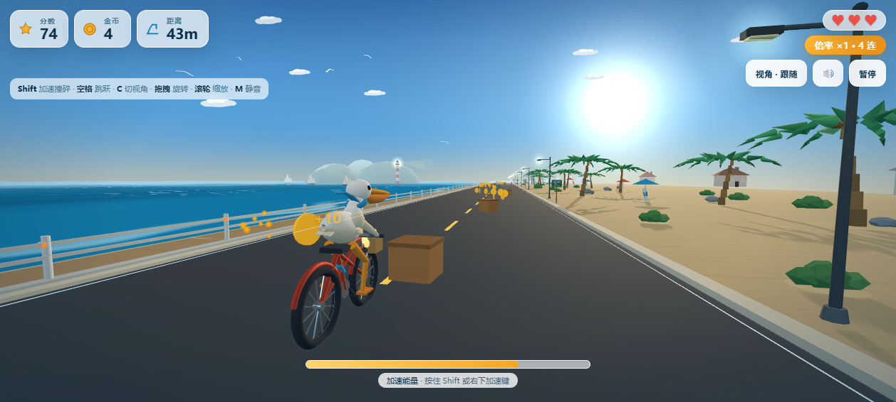

# Pelican Ride / 鹈鹕骑行 3D

一只鹈鹕骑着自行车，沿着沿海公路自动前进：抢金币、跳跃越障、加速撞碎路障、随时旋转镜头看海。

**在线试玩： https://liyue-aigc.github.io/pelican-ride/**



这是一个零构建的纯前端 3D 小游戏，打开网页就能玩，不需要账号、后端或数据库。场景、角色、海浪、音效全部由代码程序化生成，没有引入任何外部美术或音频素材。

## 玩法

| 系统 | 说明 |
| --- | --- |
| 基础循环 | 自动向前骑行，玩家只控制横向走位与节奏；比距离、金币与连击 |
| 自动吃金币 | 金币成串排布，进入磁吸半径即自动飞向鹈鹕；连击不断链则倍率递增 |
| 加速 | 按住 Shift 消耗能量（吃金币回能），得分翻倍、吸附范围变大、FOV 拉伸并出现速度线；**加速状态下可以直接撞碎障碍物**并爆出碎片、加分 |
| 跳跃 | 空格起跳，抛物线腾空超过一定高度即可越过障碍，落地有扬尘 |
| 生命值 | 3 颗心；非加速状态撞到锥桶 / 木箱 / 礁石掉 1 颗心，掉光结束 |
| 血瓶 | 路上随机刷新，捡到回 1 颗心；满血时折算成分数 |
| 道具 | 磁铁：临时大幅扩大金币吸附范围 |
| 视角 | 5 种机位（3/4 跟随、第一人称、右侧低机位、高空俯视、自由），平滑插值切换；**任意视角下拖拽画面可自由旋转 yaw / pitch，滚轮缩放距离** |
| 排行榜 | 海岸榜 Top 10，结算时输入名字上榜，记录分数 / 金币 / 距离，存在浏览器本地 |
| 成就 | 19 个成就，覆盖金币、撞碎、磁铁、血瓶、跳跃、距离、单局分数、最高连击、加速时长、无伤里程与视角探索，带进度条与解锁Toast |
| 声音 | 全部实时合成：海浪、随速度变化的风声、海鸥、轻音乐垫底，以及金币 / 跳跃 / 受伤 / 撞碎 / 成就等音效；可一键静音 |
| 存档 | 最高分、成就进度、排行榜与静音设置存在浏览器 localStorage |

## 成就一览

| 分类 | 成就 |
| --- | --- |
| 里程 | 初次上路、500m 不停脚、单局 1km、累计 10km |
| 金币 | 单局 50 金币、累计 500 金币、累计 2000 金币 |
| 战斗 | 单局撞碎 10 个、累计撞碎 100 个 |
| 道具 | 磁铁 10 个、磁铁 50 个、血瓶 20 个 |
| 跳跃 | 累计跳跃 100 次、单局跳跃 20 次 |
| 表现 | 单局 1000 分、单局 5000 分、30 连击、加速 120 秒 |
| 硬核 | 500m 无伤、探索 5 种视角 |

## 操作

| 按键 | 动作 |
| --- | --- |
| `A` / `D` 或 `←` / `→` | 左右横移 |
| `Shift` | 加速（撞碎障碍） |
| `空格` | 跳跃 |
| `C` | 切换视角并重置镜头旋转 |
| 鼠标拖拽 / 触屏拖拽 | 自由旋转镜头（第一人称下为转头） |
| 滚轮 | 拉近 / 拉远镜头 |
| `M` | 静音 / 恢复 |
| `P` / `Esc` | 暂停 |
| `R` | 结束后重开 |

手机上会自动显示左右、加速、跳跃触控按钮，操作逻辑与键盘一致。

## 技术栈

- **渲染**：Three.js 0.160.1（ESM，随仓库存放在 `vendor/`，不依赖 CDN），WebGL2，PCF 软阴影
- **海面**：自定义 `ShaderMaterial`，多层顶点位移波 + 解析法线、菲涅尔、阳光镜面高光、双层浪尖泡沫与拍岸浪线，近岸青绿过渡，按距离融入雾效
- **场景**：无限分段公路 + 对象池回收；程序化柏油颗粒、湿沙渐变、护栏、棕榈、灌木、礁石、灯塔、帆船、海鸥、远岛、路灯、路牌、沙滩伞、海景房与 Sprite 太阳光晕
- **角色**：程序化低模几何 —— 躯干与喙用自定义放样（loft）生成连续曲面，白背奶油腹用顶点色渐变；两段式腿用两骨骼 IK 把脚掌锁在脚踏上，配合蹬踏、压弯、加速前倾、腾空展翅、眨眼、张嘴、围巾飘动
- **特效**：通用 GPU 点精灵粒子系统（金币爆闪、撞碎碎片、回血、落地扬尘、加速尾迹）+ 飘字
- **音频**：WebAudio 实时合成，无音频文件；布朗噪声做海浪、带通噪声做风、锯齿波做海鸥、和弦垫做背景音乐
- **元系统**：`meta.js` 统一管理成就判定、解锁 Toast、Top10 排行榜与玩家名，全部落在 localStorage
- **物理**：不引入物理引擎，自写 AABB 碰撞与简单运动学
- **架构**：固定步长主循环，模块拆分为 `utils` / `world` / `player` / `effects` / `meta` / `audio` / `game`

## 本地运行

必须用 HTTP 打开（用了 ES module + importmap，直接双击 `index.html` 走 `file://` 会被浏览器 CORS 拦截）：

```bash
cd pelican-ride
python -m http.server 8765 --bind 127.0.0.1
```

然后访问 http://127.0.0.1:8765/index.html 。

也可以直接把整个目录丢到任意静态托管（GitHub Pages / Netlify / Vercel / OSS），无需构建步骤。

## 目录结构

```
.
├── index.html                 页面、HUD、菜单、结算、排行榜/成就面板与样式
├── src/
│   ├── game.js                主循环、状态机、碰撞、计分、输入、镜头
│   ├── world.js               沿海场景与海面 shader
│   ├── player.js              鹈鹕与自行车模型、IK 踩踏与动画
│   ├── effects.js             GPU 粒子与飘字
│   ├── meta.js                成就、排行榜、localStorage 存档
│   ├── audio.js               WebAudio 合成音效与环境音
│   └── utils.js               数学、几何放样与工具函数
├── vendor/
│   └── three.module.min.js    Three.js 0.160.1 ESM
├── favicon.svg                站内图标
├── preview.png                游戏内截图
└── .nojekyll                  让 GitHub Pages 跳过 Jekyll
```

## 许可

本项目源码采用 [MIT License](./LICENSE)。

`vendor/three.module.min.js` 来自 [three.js](https://github.com/mrdoob/three.js)，同样为 MIT 许可，版权归 three.js authors 所有。场景、角色与音效均为代码生成，无第三方美术或音频素材。
